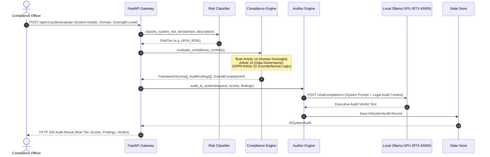

# ReguLens System Architecture

ReguLens is an enterprise Regulatory Compliance & AI Policy Radar platform that continuously audits artificial intelligence deployments against international governance frameworks (EU AI Act, NIST AI RMF 1.0, ISO/IEC 42001, and GDPR Article 22), synthesizing actionable executive legal verdicts on local GPU hardware.

---

## 1. C4 Container Diagram

```mermaid
flowchart TD
    subgraph Users["Compliance Officers & Legal Counsel"]
        Officer["Chief Compliance Officer / Risk Lead"]
    end

    subgraph ReguLens["ReguLens Platform"]
        Frontend["Frontend SPA (React 18 + Tailwind + Framework Matrix)\nPort 5173 / Static Dist"]
        APIGateway["FastAPI Gateway Engine\nPort 8007"]
        
        subgraph Pipeline["Governance Engines"]
            Classifier["Risk Tier Classifier\n(EU AI Act Annex III Mapping)"]
            ComplianceEngine["Multi-Framework Compliance Engine\n(EU AI Act, NIST, ISO 42001, GDPR)"]
            Auditor["GPU Regulatory Auditor\n(Executive Verdict & Remediation)"]
            Store["In-Memory Audit Store\n(AI Systems & Control History)"]
        end
    end

    subgraph Compute["Local GPU Compute"]
        Ollama["Ollama Engine (RTX A5000 Laptop GPU)\nModel: qwen2.5:0.5b (Port 11434)"]
    end

    Officer -->|Audits AI Deployments & Inspects Gaps| Frontend
    Frontend -->|REST API Calls| APIGateway

    APIGateway --> Classifier
    APIGateway --> ComplianceEngine
    APIGateway --> Auditor

    Classifier -->|Assigns Risk Tier| ComplianceEngine
    ComplianceEngine -->|Scores & Findings| Auditor
    Auditor -->|Generates Legal Counsel Verdict| Ollama
    Ollama-->>Auditor: Structured Executive Verdict
    Auditor -->|Persists Audit Record| Store
```

---

## 2. Regulatory Evaluation Flow (Sequence Diagram)



---

## 3. Technology Stack & Design Decisions

| Component | Technology | Rationale |
| :--- | :--- | :--- |
| **Backend Framework** | FastAPI (Python 3.12) | High-throughput asynchronous endpoints with Pydantic v2 schemas and RFC 7807 problem details. |
| **Compliance Engine** | Deterministic Multi-Framework Evaluator | Microsecond control audits (<370µs) across EU AI Act, NIST AI RMF, ISO 42001, and GDPR. |
| **Inference Engine** | Local Ollama (`qwen2.5:0.5b`) | Complete corporate confidentiality; private legal analysis on NVIDIA RTX A5000 GPU. |
| **Frontend UI** | React 18 + Tailwind CSS | Regulatory matrix dashboard with side-by-side framework cards and step-by-step technical remediation plans. |
| **Zero-Simulation** | Automated Guard Verified | 100% real compliance evaluation and real local GPU generation. |
