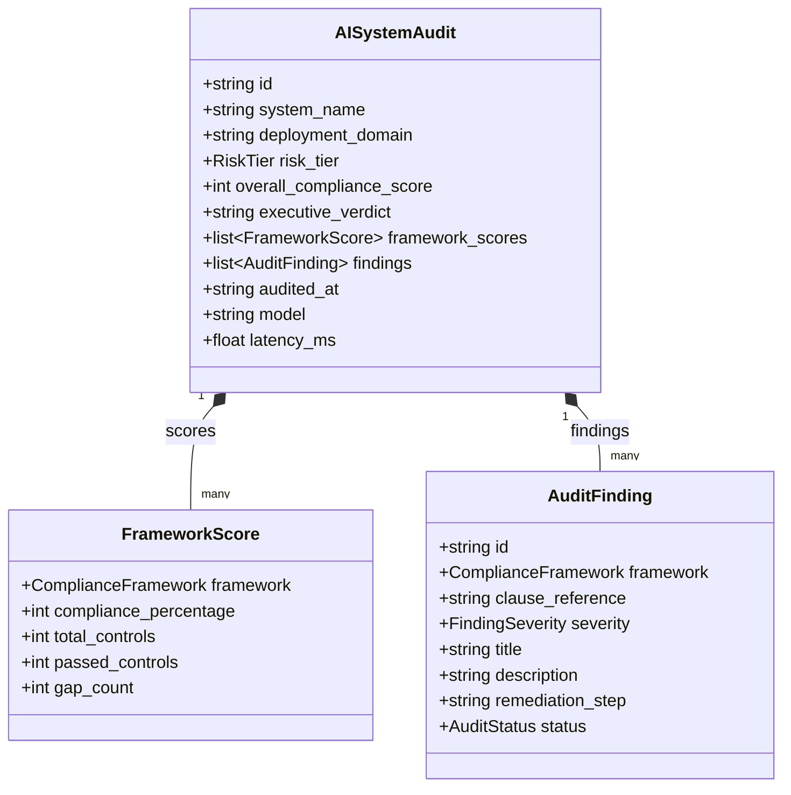

# ReguLens Data Model

This document outlines the domain entities, relationships, and data structures utilized by ReguLens for multi-framework AI regulatory compliance and policy auditing.

---

## 1. Domain Entity Relationship Diagram

---

## 2. Enums and Classification

### ComplianceFramework
- `EU_AI_ACT`: European Union Artificial Intelligence Act (Regulation EU 2024/1689).
- `NIST_AI_RMF`: NIST Artificial Intelligence Risk Management Framework (AI RMF 1.0).
- `ISO_42001`: ISO/IEC 42001:2023 Artificial Intelligence Management System (AIMS).
- `GDPR_ART_22`: General Data Protection Regulation Article 22 (Automated Decision-Making).

### RiskTier
- `UNACCEPTABLE`: Banned manipulative or biometric categorization systems.
- `HIGH_RISK`: Annex III high-impact systems (Credit underwriting, recruitment, healthcare).
- `GPAI_SYSTEMIC`: General Purpose AI with systemic risk (>10^25 FLOPs).
- `LIMITED_RISK`: Chatbots and synthetic content requiring transparency disclosures.
- `MINIMAL_RISK`: Spam filters, code formatters, and back-office sorting.

### FindingSeverity
- `CRITICAL`: Immediate statutory violation blocking deployment (e.g. absent human oversight).
- `WARNING`: Partial gap in documentation, monitoring, or dataset cards.
- `INFO`: Advisory best practice under NIST/ISO frameworks.
